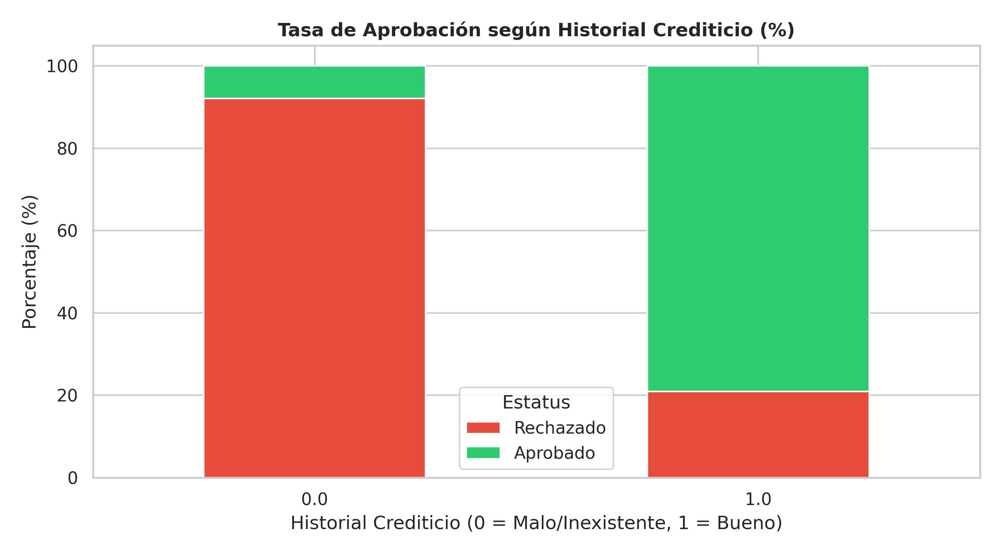
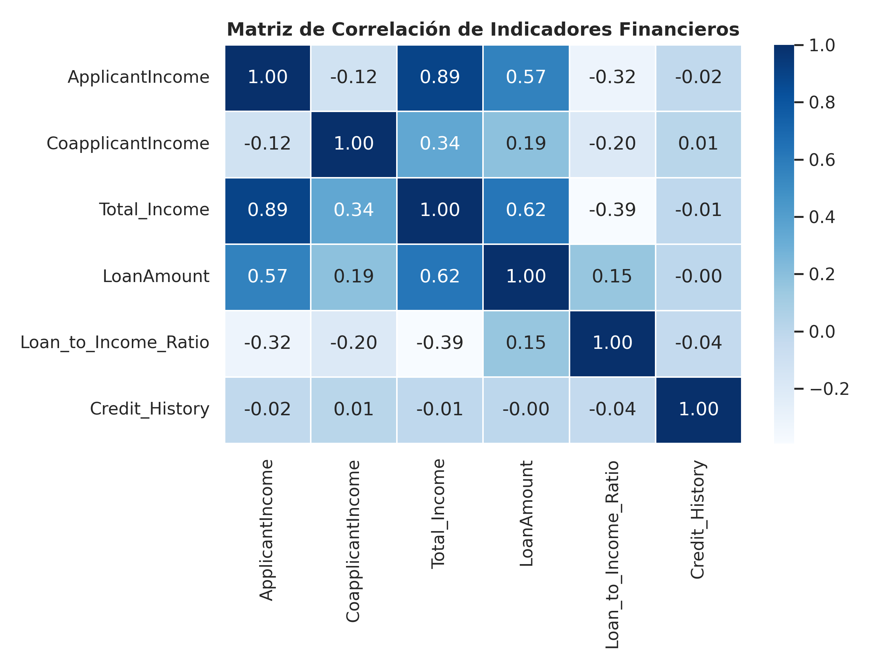

# Loan Risk & Demographic Exploratory Data Analysis (EDA)

## Project Overview
This project performs an in-depth Exploratory Data Analysis (EDA) on a financial loan application dataset. The objective is to identify key credit, socioeconomic, and demographic factors determining default risks and loan approval outcomes.

## Technical Stack
- **Language:** Python 3.10+
- **Data Manipulation & Cleaning:** Pandas, NumPy
- **Visual Analytics:** Matplotlib, Seaborn
- **Environment:** Google Colab 

## Key Findings & Business Insights
1. **Credit History as the Decisive Factor:** Applicants with a verified credit history (`Credit_History = 1`) achieved an approval rate exceeding **~79%**, whereas applicants with no or poor credit history suffered a rejection rate over **90%**.
2. **Income Skewness:** Applicant and household incomes exhibit strong positive skewness with extreme outliers, demonstrating that median-based metrics provide far more robust financial thresholds than arithmetic means.
3. **Debt-to-Income Relationship:** High income alone does not guarantee approval; applicants requesting loan amounts out of proportion with their combined household income experienced higher rejection rates.

## Visualizations

### Credit History vs. Loan Approval Rate

### Correlation Matrix of Financial Metrics

## Repository Structure
